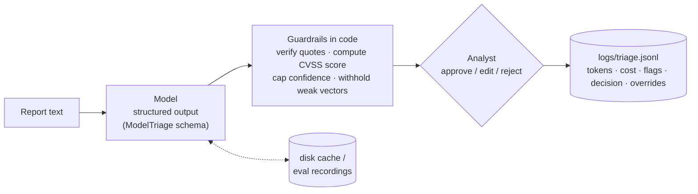

# vuln-triage

[](https://github.com/LorenzoAPB/vuln-triage/actions/workflows/ci.yml)

An LLM drafts the triage of a security vulnerability report, code checks every claim it can, and a human approves, edits, or rejects the draft. Nothing is final until a person decides.


## The problem

A PSIRT inbox mixes detailed advisories, one-line "found an XSS, please fix" emails, scanner output, and messages that are not vulnerability reports at all. For each one, an analyst has to work out what is affected, map the weakness to a CWE, read a CVSS v3.1 vector out of prose, and decide what happens next. That first pass is slow and repetitive, and its output feeds severity SLAs, so mistakes are expensive in both directions.

A language model can write that first draft in seconds. The risks are the familiar ones: confident numbers with nothing behind them, quotes the reporter never wrote, and a triage forced onto text that was never a report. This project is a small, inspectable answer to the question: how much of the first pass can a cheap model draft, and what has to stay in code and with a human?

## How it works



| File | What it does |
|---|---|
| [`vuln_triage/schema.py`](vuln_triage/schema.py) | `ModelTriage`: what the model may return. `TriageResult`: the draft a human reviews. |
| [`vuln_triage/triage.py`](vuln_triage/triage.py) | One Responses API call with structured outputs, a disk cache, token usage, and cost. |
| [`vuln_triage/guardrails.py`](vuln_triage/guardrails.py) | `finalize()`: turns the model's proposal into a draft, trusting nothing that code can check. |
| [`vuln_triage/cli.py`](vuln_triage/cli.py) | The review loop and the JSONL log. |
| [`evals/`](evals) | 48 labeled reports, the metric code, recorded responses, and [results](evals/results.md). |

## Design choices

**Structured outputs instead of "please answer in JSON".** The Pydantic schema is sent as a strict JSON schema, so every response parses, every field is present, and enum fields (each CVSS metric, the confidence level) can only take legal values. Parsing errors, refusals, and truncation surface as one `TriageError` and are logged as `parse_failure`.

**The CVSS score is computed in code.** The model proposes the eight base metrics; the [`cvss`](https://pypi.org/project/cvss/) library computes the score, and the severity band follows from it. A model can easily say "9.8" for a vector that scores 7.5. Arithmetic is not its job.

**Per-metric evidence.** Each metric comes with the exact report text that supports it, or `''` when the model is inferring. Code checks every quote against the report (case- and whitespace-insensitive substring match). A metric without a verified quote counts as guessed. One guess caps confidence at medium. More than four guesses, or a report under 120 characters, and the vector is withheld: the analyst sees the model's guess, labeled as a guess, but no score is published.

**Every claim cites the report.** Evidence quotes that do not appear in the report are dropped and flagged (`dropped_N_unverified_quotes`). No verified evidence at all means low confidence.

**`unknown` is a legal answer, except for CVSS metrics.** Strict schemas make every field required, so without an explicit `unknown` the model is pushed to invent a CWE or a product. CVSS metrics are the exception, for a reason found in the eval: when each metric could be `unknown`, the model left at least one unknown on every NVD item, so no severity was ever produced ([first run](docs/eval-v1-gpt-5.4-nano.md)). Now the model always proposes, and code decides from the evidence whether to publish.

**Three confidence levels, not a percentage.** "0.87" invites false precision. Low, medium, and high are levels a reviewer can check, and code can lower them (never raise them) based on what it verified.

**Non-reports are refused.** `is_vulnerability_report: false` short-circuits to an empty draft with "route back to sender" as the next step, instead of a CVSS score for an offsite reminder.

**Human in the loop, with a record.** The analyst can edit the CWE, the vector (the score and severity are recomputed), the severity, and the product, or reject with a reason. Each run logs model, latency, tokens, estimated cost, guardrail flags, the decision, and every field the human changed with the model's value next to theirs. Those overrides are the data you would use to improve the prompt.

**Cheap model, cached calls.** `gpt-5-mini` at minimal reasoning effort costs about a tenth of a cent per report. Responses are cached on disk, keyed by model, prompt, schema, and report text, so re-runs are free and the eval replays exactly. Prices live in one constant (`PRICES_PER_MTOK`) with the source URL and the date they were checked.

## Results

48 items: 36 NVD records (9 per severity, chosen by a fixed rule in [`build_dataset.py`](evals/build_dataset.py) and labeled with NVD's own CVSS 3.1 vector and CWE) and 12 hand-written synthetic items (4 thin reports, 2 vague reports, 6 non-reports). Model `gpt-5-mini`, 0 parse failures. Full tables and per-item output: [`evals/results.md`](evals/results.md).

| What | Result |
|---|---|
| Report vs noise: report precision / recall | 100% / 98% (42 reports) |
| Report vs noise: noise precision / recall | 86% / 100% (6 non-reports) |
| Severity published (vector passed the guardrails) | 67% of NVD items |
| Severity accuracy when published | 42% |
| Severity accuracy of the raw model vector, no guardrails | 44% (19 over-scored, 1 under-scored) |
| CWE exact match with NVD primary CWE | 17% (75% answered `unknown`) |
| CVSS vector exact match, raw model vector | 22% |
| Per-metric agreement AV / AC / PR / UI / S / C / I / A | 69% / 89% / 81% / 89% / 81% / 64% / 64% / 78% |
| Thin and vague reports (6) | 6 low confidence, 5 with the vector withheld |
| Cost and latency | 52,667 input + 24,572 output tokens, about $0.0623; median 9.5 s per call |

| Severity | Precision | Recall | Predicted |
|---|---|---|---|
| Critical | 45% | 56% | 11 |
| High | 38% | 33% | 8 |
| Medium | 40% | 22% | 5 |
| Low | n/a | 0% | 0 |

What the numbers say:

- **The model over-scores.** Of the 36 raw vectors, 19 score higher than NVD's and 1 lower. It never predicted Low. It defaults to the worst case on impact (C and I agree with NVD only 64% of the time), which is the part of a vector that short descriptions leave implicit.
- **The evidence rule does not find the bad vectors.** Withholding mostly-guessed vectors leaves accuracy flat (42% published vs 44% raw), and the raw vectors it withheld were right 50% of the time. A quote can exist in the report and still not support the metric it is attached to; the model often cites the same sentence for four metrics. Substring verification catches invented text, not weak reasoning.
- **Confidence carries some signal, on very few items.** Severity was right on 4 of 4 medium-confidence items and 19% of the 32 low-confidence ones.
- **CWE mostly comes back `unknown`.** The prompt forbids outside knowledge and requires evidence for every claim, and the model reads that as "do not name a CWE unless the text names it". NVD analysts map CWEs from expertise, not quotes.
- **Report detection works.** The one miss was a vague second-hand warning ("a friend in IT said your servers might be vulnerable") that is arguably not a report.

The labels set a ceiling. NVD analysts score with knowledge the description does not contain (how the product is deployed, whether a login is needed), so "agreement with NVD" is not the same as "correct from the text". Thirty-six items also means each severity class has 9 examples; one item moves a class's recall by 11 points.

## Limits

- Severity accuracy is far too low to use without review. The tool drafts; the analyst decides.
- Quote verification proves a quote exists, not that it supports the claim.
- The thin-report threshold (120 characters) is a blunt rule, and it was lowered after looking at the first eval run, so the eval is not independent of it.
- One model, one prompt, one run. The two eval runs differ in both schema and model (an account limit of 50 requests per model per day forced the switch), so they are not a model comparison.
- NVD descriptions are cleaner than real inbound reports. The synthetic items are hand-written and few.
- Prompt injection inside a report is not handled beyond the schema constraint and the human gate.

## Ethics and safety

- **Assist, never replace.** Every result is a draft until an analyst approves it, and the log records who changed what. Severity drives patch SLAs and customer notifications; that decision stays with a person.
- **No internal data.** The eval uses only public NVD records and synthetic text written for this repo. Nothing from any employer or customer is in the data, prompts, or logs.
- **Dual use.** The tool reads reports and summarizes them; it does not write exploits or search for vulnerabilities. Run on private reports, it sends their text to a third-party API, so check your disclosure agreements and data-handling rules before pointing it at a real inbox.

## Run it

Requires Python 3.12+.

```bash
git clone https://github.com/LorenzoAPB/vuln-triage && cd vuln-triage
python -m venv .venv && source .venv/bin/activate
pip install -e ".[dev]"

make test          # pytest, API mocked, no network
make eval          # replay the recorded eval responses; free and deterministic

export OPENAI_API_KEY=...   # only needed for new reports
vuln-triage triage examples/cve-2021-44228.txt --out triaged.json
python -m evals.run         # live eval for items without a recording, rewrites evals/results.*
```

`--model` selects another model; add its prices to `PRICES_PER_MTOK` first. Logs go to `logs/triage.jsonl`.

CI runs ruff, the test suite, and `python -m evals.run --offline --check`, which replays the recorded responses and fails if the metrics differ from the committed results. A one-call live smoke test runs only if the repository has an `OPENAI_API_KEY` secret.

## License

[MIT](LICENSE)
