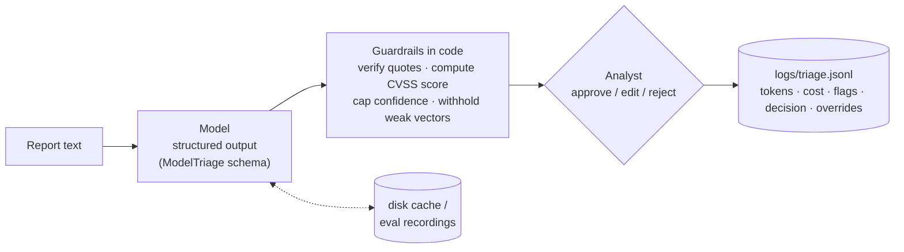

# vuln-triage

[](https://github.com/LorenzoAPB/vuln-triage/actions/workflows/ci.yml)

An LLM drafts the triage of a security vulnerability report, code checks every claim it can, and a human approves, edits, or rejects the draft. Nothing is final until a person decides.


<sub>Runs with the defaults (`gpt-5-mini`, prompt v4) and replays recorded `gpt-5-mini` responses from the held-out test run (cache `evals/recordings`), so it makes no API calls. The first line of each draft names the model and prompt version.</sub>

## The problem

A PSIRT inbox mixes detailed advisories, one-line "found an XSS, please fix" emails, scanner output, and messages that are not vulnerability reports at all. For each one, an analyst has to work out what is affected, map the weakness to a CWE, read a CVSS v3.1 vector out of prose, and decide what happens next. That first pass is slow and repetitive, and its output feeds severity SLAs, so mistakes are expensive in both directions.

A language model can write that first draft in seconds. The risks are the familiar ones: confident numbers with nothing behind them, quotes the reporter never wrote, and a triage forced onto text that was never a report. This project is a small, inspectable answer to the question: how much of the first pass can a cheap model draft, and what has to stay in code and with a human?

## How it works



| File | What it does |
|---|---|
| [`vuln_triage/schema.py`](vuln_triage/schema.py) | `ModelTriage`: what the model may return. `TriageResult`: the draft a human reviews. |
| [`vuln_triage/triage.py`](vuln_triage/triage.py) | Prompt versions, one Responses API call with structured outputs, a disk cache, token usage, and cost. |
| [`vuln_triage/retrieval.py`](vuln_triage/retrieval.py) | TF-IDF nearest neighbours over 16,832 NVD-scored CVEs from 2022 (used by the `exp-knn` experiment and the no-LLM baseline). |
| [`vuln_triage/guardrails.py`](vuln_triage/guardrails.py) | `finalize()`: turns the model's proposal into a draft, trusting nothing that code can check. |
| [`vuln_triage/cli.py`](vuln_triage/cli.py) | The review loop and the JSONL log. |
| [`evals/`](evals) | A 39-item dev split for iteration, a 48-item held-out test split, metric code, a Batch API runner, recorded responses, the [dev ablation](evals/ablation.md), and [history](evals/history) of every run. |

## Design choices

**Structured outputs instead of "please answer in JSON".** The Pydantic schema is sent as a strict JSON schema, so every response parses, every field is present, and enum fields (each CVSS metric, the confidence level) can only take legal values. Parsing errors, refusals, and truncation surface as one `TriageError` and are logged as `parse_failure`.

**The CVSS score is computed in code.** The model proposes the eight base metrics; the [`cvss`](https://pypi.org/project/cvss/) library computes the score, and the severity band follows from it. A model can easily say "9.8" for a vector that scores 7.5. Arithmetic is not its job.

**Per-metric evidence.** Each metric comes with the exact report text that supports it, or `''` when the model is inferring. Code checks every quote against the report (case- and whitespace-insensitive substring match). A metric counts as guessed if its quote is missing, is not in the report, or is the same sentence cited for more than three metrics (one sentence cannot carry most of a vector; the v2 test run on `gpt-5-mini` found the model doing exactly that). One guess caps confidence at medium. Reports under 120 characters get no score.

**Inferred metrics are labeled, not hidden (v4).** Until v3, more than four metrics without a verified quote meant the vector was withheld. On the held-out run with `gpt-4o-mini` that withheld 92% of vectors, mostly because the model correctly left quotes empty for metrics a description never states (NVD analysts infer those too). v4 publishes such a vector flagged `cvss_provisional`, with the inferred metrics listed next to it and confidence set to low. Every draft is reviewed by an analyst, so an honestly labeled draft is more useful than no draft. Thin reports are still withheld.

**Score what the report states, not the worst case.** The prompt spells out standard CVSS v3.1 practice: C/I/A are High only for total loss, a crash affects availability only, PR:N needs the report to say or clearly imply no account, S:C needs a crossed security boundary. This targets the over-scoring measured in the v2 test run on `gpt-5-mini`.

**Every claim cites the report.** Evidence quotes that do not appear in the report are dropped and flagged (`dropped_N_unverified_quotes`). No verified evidence at all means low confidence.

**CWE is classification, so the model may use its CWE knowledge.** Facts about the product come only from the report, but mapping "a missing buffer size check" to CWE-787 is classification, which is what an NVD analyst does. The model gives the most specific CWE plus a `cwe_quote` describing the weakness; if that quote is not in the report, code resets the CWE to `unknown` (`cwe_without_evidence`). In the v2 test run on `gpt-5-mini`, forbidding outside knowledge made the model answer `unknown` for 75% of CWEs.

**`unknown` is a legal answer, except for CVSS metrics.** Strict schemas make every field required, so without an explicit `unknown` the model is pushed to invent a CWE or a product. CVSS metrics are the exception, for a reason found in the eval: when each metric could be `unknown`, the model left at least one unknown on every NVD item, so no severity was ever produced ([first run: v1 schema, `gpt-5.4-nano`](evals/history/v1-test-gpt-5.4-nano.md)). Now the model always proposes, and code decides from the evidence whether to publish.

**Three confidence levels, not a percentage.** "0.87" invites false precision. Low, medium, and high are levels a reviewer can check, and code can lower them (never raise them) based on what it verified.

**Non-reports are refused.** `is_vulnerability_report: false` short-circuits to an empty draft with "route back to sender" as the next step, instead of a CVSS score for an offsite reminder.

**Human in the loop, with a record.** The analyst can edit the CWE, the vector (the score and severity are recomputed), the severity, and the product, or reject with a reason. Each run logs model, latency, tokens, estimated cost, guardrail flags, the decision, and every field the human changed with the model's value next to theirs. Those overrides are the data you would use to improve the prompt.

**Cheap model, cached calls.** The CLI defaults to `gpt-5-mini` at minimal reasoning effort (`MODEL` in [`triage.py`](vuln_triage/triage.py)); the v2 test run on it cost $0.0623 for 48 reports. The current held-out results were also produced by `gpt-5-mini`, with prompt v4. Evals go through the [Batch API](evals/batch.py): half price, and limits separate from the account's 50 requests per model per day, which had forced earlier runs onto different models. Responses are cached on disk, keyed by model, prompt, schema, and report text, so re-runs are free and the eval replays exactly. Prices live in one constant (`PRICES_PER_MTOK`) with the source URL and the date they were checked.

**What prior work suggested, and what was tested here.** Three studies shaped the v4 experiments:
- [AutoCVSS (EMNLP 2025, Industry Track)](https://aclanthology.org/2025.emnlp-industry.38.pdf) found retrieval of similar CVEs as few-shot examples to be the best LLM prompting strategy for CVSS prediction. That became the `exp-knn` experiment, with local TF-IDF retrieval over 2022 NVD records instead of an embedding service.
- [Marchiori, Donadel, and Conti, "Can LLMs Classify CVEs?" (arXiv 2504.10713)](https://arxiv.org/abs/2504.10713) found embedding-based classifiers beat LLMs on the subjective C/I/A metrics and suggested combining the two. That became the no-LLM nearest-neighbour baseline and the "fill inferred metrics from neighbours" variant.
- ["Knowledge-Driven Large Language Models for Automating CVSS Score Prediction" (ACM, 2025)](https://doi.org/10.1145/3733817.3762699) reported large gains from explicit expert scoring rules in the prompt, which is the approach the v3 CVSS guidance already takes.

On this data, retrieval helped CWE on `gpt-4o-mini` but not severity, and the neighbour vote was a strong free baseline (see the [ablation](#dev-split-ablation-what-each-idea-did)).

## Evaluation method

Two splits, both built by the same fixed rule in [`build_dataset.py`](evals/build_dataset.py) (NVD records where NVD itself assigned the CVSS 3.1 vector and a specific CWE, 150-900 character descriptions, no SAP, first N per severity with distinct CWEs) from different publication windows:

| Split | Items | Window | Used for |
|---|---|---|---|
| dev | 36 NVD (3 per severity from June-July 2023, 6 per severity from September-October 2023) + 3 synthetic | June-July and September-October 2023 | All prompt and guardrail iteration |
| test | 36 NVD (9 per severity) + 12 synthetic | March-April 2023 | Held out; run once per finished version |
| retrieval pool | 16,832 NVD-scored CVEs ([`build_pool.py`](evals/build_pool.py)) | 2022 | Nearest-neighbour experiments only; never scored |

Labels are NVD's CVSS 3.1 vector and primary CWE. The lenient CWE metric counts a direct parent or child in MITRE's Research view (CWE-1000, from [`cwe_parents.json`](evals/cwe_parents.json), built by [`build_cwe_tree.py`](evals/build_cwe_tree.py)). Every number below is generated by `python -m evals.run` or `python -m evals.compare`; snapshots of each run are in [`evals/history`](evals/history).

## Results

Every number below names the model and the prompt version that produced it, and is copied from a generated file under [`evals/`](evals).

### Current held-out numbers: v4, `gpt-5-mini`, held-out test

Test split, 48 items, 0 parse failures, from [`evals/results.md`](evals/results.md). The responses were recorded once, through the Batch API, on 2026-11-11. v4 sends exactly the same requests as v3 and changes only the publishing rule, so the v3 and v4 numbers below come from the same recorded responses.

| What | Result |
|---|---|
| Report vs noise: report precision / recall | 100% / 98% (42 reports) |
| Report vs noise: noise precision / recall | 86% / 100% (6 non-reports) |
| Severity published | 100% of NVD items |
| Severity accuracy (published = all) | 39% (13 over-scored, 9 under-scored) |
| Raw minus NVD base score | mean +0.07, mean absolute 1.87 |
| CWE exact match with NVD primary CWE | 47% (3% answered `unknown`) |
| CWE exact or direct parent/child (lenient) | 67% |
| CVSS vector exact match | 17% |
| Per-metric agreement AV / AC / PR / UI / S / C / I / A | 81% / 89% / 78% / 86% / 94% / 50% / 56% / 72% |
| Thin and vague reports (6) | 6 low confidence, 5 with the vector withheld |
| Cost | 70,667 input + 24,635 output tokens, about $0.0335 (Batch API, half price) |

| Severity | Precision | Recall | Predicted |
|---|---|---|---|
| Critical | 57% | 44% | 7 |
| High | 27% | 33% | 11 |
| Medium | 38% | 67% | 16 |
| Low | 100% | 11% | 1 |

### Same-model before/after on the held-out test (`gpt-5-mini`)

The v2, v3, and v4 runs below all used `gpt-5-mini` at minimal reasoning effort on the same 48 items, so they are a controlled comparison. Generated by `python -m evals.compare` ([v2 vs v3](evals/history/compare-v2-test-gpt-5-mini-vs-v3-test-gpt-5-mini.md), [v3 vs v4](evals/history/compare-v3-test-gpt-5-mini-vs-v4-test-gpt-5-mini.md), [v2 vs v4](evals/history/compare-v2-test-gpt-5-mini-vs-v4-test-gpt-5-mini.md)); selected rows:

| Metric | v2, `gpt-5-mini` | v3, `gpt-5-mini` | v4, `gpt-5-mini` |
|---|---|---|---|
| CWE exact | 17% | 47% | 47% |
| CWE parent/child (lenient) | 17% | 67% | 67% |
| CWE unknown | 75% | 3% | 3% |
| Raw vectors over-scored / under-scored | 19 / 1 | 13 / 9 | 13 / 9 |
| Raw minus NVD base score, mean | +1.31 | +0.07 | +0.07 |
| Raw minus NVD base score, mean absolute | 1.49 | 1.87 | 1.87 |
| Severity published (coverage) | 67% | 28% | 100% |
| Severity accuracy when published | 42% | 40% | 39% |
| Severity correct, all NVD items (withheld = miss) | 28% | 11% | 39% |
| Severity accuracy, raw vector | 44% | 39% | 39% |
| Vector exact, raw | 22% | 17% | 17% |
| Cost (USD) | $0.0623 | $0.0335 | $0.0335 |

What changed, honestly:

- **CWE improved a lot.** Letting the model classify the weakness (v3) took exact CWE matches from 17% to 47% and parent/child matches from 17% to 67%, while `unknown` answers fell from 75% to 3%.
- **The systematic over-scoring is gone, but the scores are not closer.** The mean score bias fell from +1.31 to +0.07 and over-scoring from 19 items to 13, but under-scoring rose from 1 to 9 and the mean absolute error went up (1.49 to 1.87). Raw severity accuracy did not improve (44% to 39%; one item is about 3 points).
- **Coverage went from 67% to 100%.** v4 gives every non-thin report a labeled severity. Correct severities across all 36 NVD items went from 28% (v2) to 39% (v4) because nothing is withheld, not because the vectors got better.

The same publishing change on `gpt-4o-mini` ([v3 vs v4](evals/history/compare-v3-test-gpt-4o-mini-vs-v4-test-gpt-4o-mini.md), same recorded responses): coverage 8% to 100%, accuracy when published 67% to 42%, correct across all NVD items 6% to 42%.

### Dev-split ablation: what each idea did

All iteration ran on the dev split (36 NVD items). Full table: [`evals/ablation.md`](evals/ablation.md), generated by `python -m evals.ablation` and replayed in CI. Selected rows:

| Configuration | Model | Published | Severity correct (all) | Score MAE | CWE exact |
|---|---|---|---|---|---|
| Nearest-neighbour vote (k=5), no LLM | none | 100% | 44% | 1.56 | 39% |
| v3: withhold mostly-inferred vectors | gpt-4o-mini | 3% | 3% | 1.68 | 47% |
| v4: v3 prompt, publish as provisional | gpt-4o-mini | 100% | 47% | 1.68 | 47% |
| exp-knn: + 5 similar NVD CVEs in the prompt | gpt-4o-mini | 100% | 42% | 1.54 | 53% |
| exp-knn, inferred metrics from the neighbour vote | gpt-4o-mini | 100% | 42% | 1.64 | 53% |
| v3: withhold mostly-inferred vectors | gpt-5-mini | 39% | 28% | 1.15 | 64% |
| v4: v3 prompt, publish as provisional | gpt-5-mini | 100% | 56% | 1.15 | 64% |
| exp-knn: + 5 similar NVD CVEs in the prompt | gpt-5-mini | 100% | 50% | 1.31 | 61% |
| exp-low: v4 at low reasoning effort | gpt-5-mini | 100% | 47% | 1.36 | 67% |
| exp-knn-low: exp-knn at low reasoning effort | gpt-5-mini | 100% | 42% | 1.51 | 67% |

- **Provisional publishing** was the one change that clearly helped: same responses, coverage from 39% to 100% on `gpt-5-mini`. It became v4.
- **Retrieved examples** (the 5 most similar 2022 NVD CVEs with their NVD vectors, as in AutoCVSS) helped the weaker model's CWE (47% to 53% exact, `unknown` 33% to 11%) and its score MAE, but not severity, and on `gpt-5-mini` they made severity and MAE slightly worse. The retriever often matches on product names (for example, DrayTek) as much as on the weakness, which may be why.
- **Low reasoning effort** cost about twice as much and did not help severity on dev.
- **The no-LLM nearest-neighbour vote** was competitive on severity (44%) and free. That matches prior work: embedding-based methods do well on the subjective impact metrics. Filling the model's inferred metrics from the vote made over-scoring worse (17 over, 4 under), so it was dropped.
- **Dev did not predict test.** v4 on `gpt-5-mini` got 56% severity accuracy on dev and 39% on the held-out test. With 36 items per split, one item is about 3 points, and the dev numbers were used to choose, so expect them to be optimistic.

### Earlier runs on other models

- [v3 on `gpt-4o-mini`](evals/history/v3-test-gpt-4o-mini.md) (held-out test, 48 items): run when `gpt-5-mini`'s daily quota was used up. 8% of severities published; CWE exact 36%.
- [v1 on `gpt-5.4-nano`](evals/history/v1-test-gpt-5.4-nano.md): abstained on every vector.
- v3 dev iteration on `gpt-5-nano` (old 15-item dev split): [`evals/history`](evals/history).

The labels set a ceiling. NVD analysts score with knowledge the description does not contain (how the product is deployed, whether a login is needed), so "agreement with NVD" is not the same as "correct from the text".

## Limits

- Severity accuracy is far too low to use without review. The tool drafts; the analyst decides.
- Quote verification proves a quote exists, not that it supports the claim.
- The thin-report threshold (120 characters) is a blunt rule, and it was lowered after looking at the first eval run, so the eval is not independent of it.
- Small splits: 36 NVD items each in dev and test, so one item is about 3 points, and one run per version. Only the `gpt-5-mini` v2/v3/v4 runs (and the `gpt-4o-mini` v3/v4 pair) are controlled comparisons; v1 ran on `gpt-5.4-nano`.
- The v3 `gpt-5-mini` test numbers were seen before v4 was picked. v4 was chosen on the dev ablation and changes only the publishing rule, but it is not a perfectly blind choice.
- Severity accuracy did not improve from v2 to v4 on the same model; the gains are CWE, bias, and coverage.
- NVD descriptions are cleaner than real inbound reports. The synthetic items are hand-written and few.
- Prompt injection inside a report is not handled beyond the schema constraint and the human gate.

## Ethics and safety

- **Assist, never replace.** Every result is a draft until an analyst approves it, and the log records who changed what. Severity drives patch SLAs and customer notifications; that decision stays with a person.
- **No internal data.** The eval uses only public NVD records and synthetic text written for this repo. Nothing from any employer or customer is in the data, prompts, or logs.
- **Dual use.** The tool reads reports and summarizes them; it does not write exploits or search for vulnerabilities. Run on private reports, it sends their text to a third-party API, so check your disclosure agreements and data-handling rules before pointing it at a real inbox.

## Run it

Requires Python 3.12+.

```bash
git clone https://github.com/LorenzoAPB/vuln-triage && cd vuln-triage
python -m venv .venv && source .venv/bin/activate
pip install -e ".[dev]"

make test          # pytest, API mocked, no network
make eval          # replay the recorded eval responses; free and deterministic

export OPENAI_API_KEY=...   # only needed for new reports
vuln-triage triage examples/cve-2021-44228.txt --out triaged.json
python -m evals.batch --split dev && python -m evals.run --split dev --offline    # iterate here (Batch API)
python -m evals.batch --split test && python -m evals.run --split test --offline  # held out: once per finished version
python -m evals.ablation           # dev ablation table from recorded responses
```

The defaults are model `gpt-5-mini` and prompt `v4` (`vuln-triage triage --help` shows both), the same configuration as the current held-out results. `--model` and `--prompt` select others; every version with recorded results stays in `PROMPTS` so it can be replayed. Add a new model's prices to `PRICES_PER_MTOK` first. Logs go to `logs/triage.jsonl`.

CI runs ruff, the test suite, `python -m evals.run --split dev --offline --check`, the same for the test split, and `python -m evals.ablation --check`, which replay the recorded responses and fail if the metrics differ from the committed results. A one-call live smoke test runs only if the repository has an `OPENAI_API_KEY` secret.

## License

[MIT](LICENSE)
